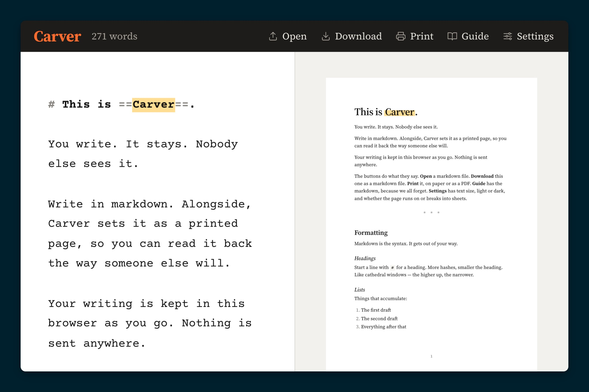

# Carver
A markdown editor. Minimal by design, private by default, delightful by nature.

## Settings
| Label | Options |
|---------|---------|
| Text size | Small (14px) / Medium (16px) / Large (18px) |
| Preview | Continuous (default) / Paged — Paged breaks the proof into real pages, and Print outputs exactly those pages. The paper (A4 or US Letter) follows the browser's locale |
| Appearance | Light / Dark — follows the system until you choose; the whole desk; printing is always light |

The typescript and the proof always scroll together, matched by content.

## Privacy
- Runs entirely in the browser. No accounts, no servers, no data leaves the page.
- Fonts (Source Serif 4 for the proof and interface, Courier Prime for the typescript) are self-hosted as woff2 files.
- Your document and settings are saved to `localStorage`.

## Stack
- Vite (vanilla JS)
- CodeMirror 6
- markdown-it (+ markdown-it-mark for `==highlight==`)
- Vitest (unit tests)
- Playwright (E2E tests, requires local install — see below)
